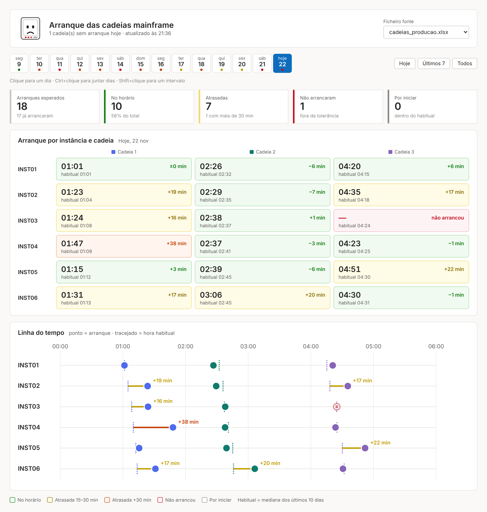
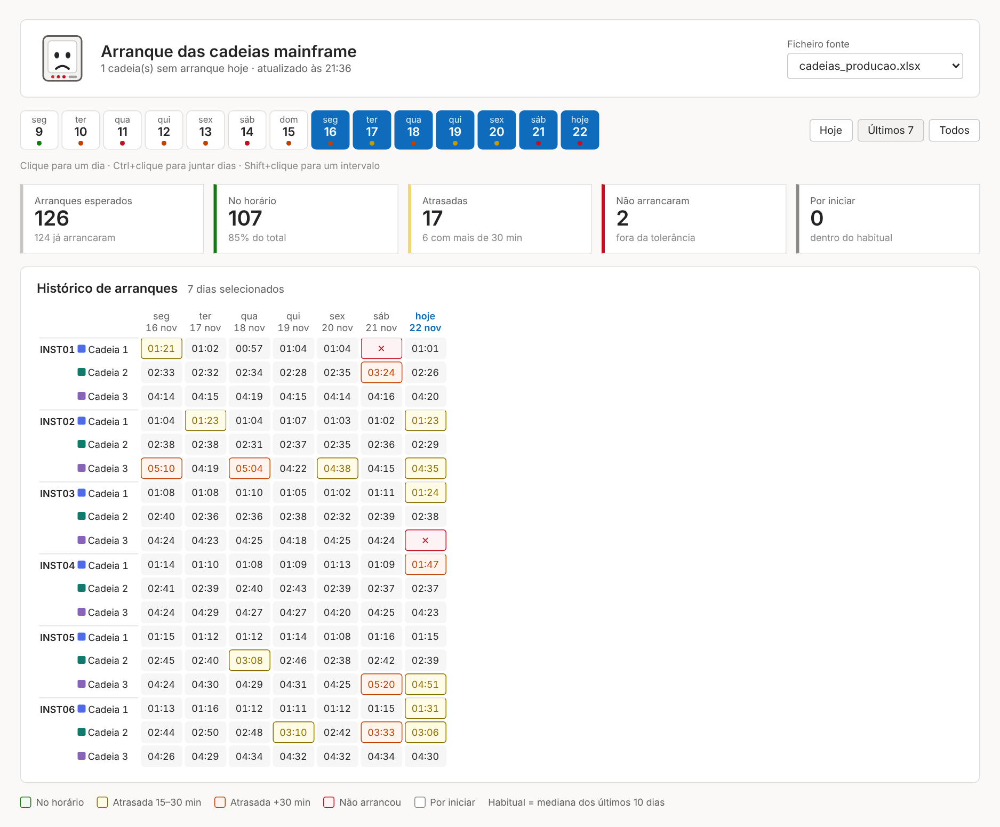

# Dashboard de cadeias mainframe (SPFx)

Web part para SharePoint Online que mostra o **arranque das cadeias de jobs mainframe** a partir de um Excel guardado numa biblioteca de documentos.

- SPFx 1.18.2 · React 17 (class components) · TypeScript 4.7 · Node 16.13
- PnPjs v3 para ler a biblioteca · SheetJS para ler o Excel no browser (sem servidores externos em runtime)
- Gráficos e mascote em SVG próprio; animações respeitam `prefers-reduced-motion`

| Um dia | Vários dias |
|---|---|
|  |  |

## O que mostra

- **6 instâncias × 3 cadeias**: hora de arranque de cada cadeia e desvio face à hora habitual (mediana dos últimos N dias).
- Estados: no horário · atrasada 15–30 min · atrasada +30 min · não arrancou · por iniciar.
- **Um dia selecionado** → grelha instâncias × cadeias + linha do tempo.
- **Vários dias** (Ctrl/Shift+clique, "Últimos 7", "Todos") → matriz de histórico.
- Mascote mainframe cujo humor reflete o estado do dia de hoje.

## Começar

```bash
nvm use 16.13.0
npm install
gulp trust-dev-cert   # só na primeira vez
gulp serve
```

Abrir `https://<tenant>.sharepoint.com/sites/<site>/_layouts/15/workbench.aspx` e adicionar a web part **Cadeias mainframe**.
Por omissão usa **dados fictícios**. Para o Excel real, no painel de propriedades:

| Propriedade | Exemplo |
|---|---|
| Fonte | Excel na biblioteca SharePoint |
| Pasta da biblioteca | `/sites/Operacoes/Shared Documents/Jobs` |
| Nome da sheet | vazio = primeira sheet |
| Instâncias | `INST01,INST02,INST03,INST04,INST05,INST06` |

Para publicar: `npm run package` e carregar `sharepoint/solution/dashboard-mainframe-jobs-spfx.sppkg` no App Catalog.

> Se o `npm install` não conseguir aceder ao `cdn.sheetjs.com`, trocar a dependência `xlsx` por `"xlsx": "0.18.5"`.

## Estrutura do Excel esperada

| Data | Hora | Nome do processo | Estado | Status final |
|---|---|---|---|---|
| 2026/11/22 | 01:02:30 | INST01_C1 | started | |

- O cabeçalho é detetado nas primeiras 30 linhas (a tabela não precisa de começar em A1).
- Datas aceites: `yyyy/mm/dd`, `yyyy-mm-dd`, `dd/mm/yyyy` ou data Excel; horas em texto ou formato hora Excel.
- Por agora só as linhas `started` são usadas.

## Estrutura do código

```
src/webparts/dashboardCadeias/
├── DashboardCadeiasWebPart.ts          painel de propriedades; escolhe o serviço (mock / SharePoint)
├── components/
│   ├── DashboardCadeias.tsx            raiz (estado: ficheiro, dias, dados, relógio)
│   ├── Cabecalho.tsx · Mascote.tsx
│   ├── SeletorDias.tsx · Kpis.tsx · Seccao.tsx · Legenda.tsx
│   ├── GrelhaArranques.tsx             1 dia: instâncias × cadeias
│   ├── LinhaTempo.tsx                  1 dia: arranque vs hora habitual
│   ├── MatrizHistorico.tsx             vários dias
│   ├── estilos.ts
│   └── DashboardCadeias.module.scss
├── models/IModelos.ts
├── services/
│   ├── IJobDataService.ts · MockJobDataService.ts · SharePointExcelService.ts
│   ├── excelParser.ts                  deteta cabeçalho, normaliza datas e horas
│   └── modelo.ts                       hora habitual, desvio, estado, contagens
└── utils/ config.ts · util.ts
```

## Pontos provisórios

- Nome do processo → instância/cadeia: `chaveProcesso()` em `utils/config.ts` assume `INST01_C2`.
- Hora habitual = mediana; se houver hora prevista, muda-se em `services/modelo.ts`.
- Próximo passo planeado: vista em árvore/Gantt dos jobs assíncronos de cada cadeia (requer eventos `started`/`ended` por job).
